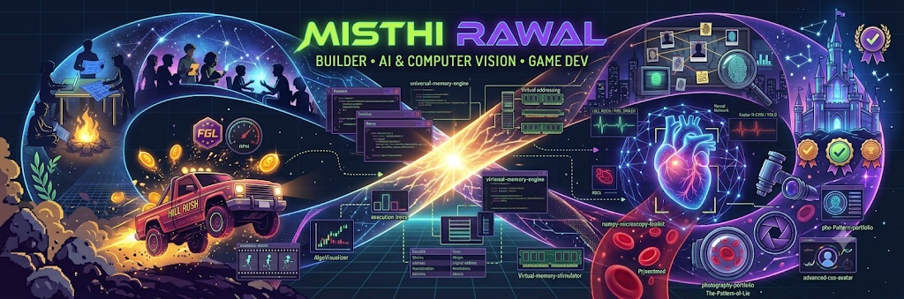

  

  <h1>Misthi Rawal</h1>
  
<b>Full-Stack Software Engineer • Computer Vision & AI • Systems & Game Dev</b>

  
<i>Engineering evidence-first platforms, interactive runtime memory visualizers, medical imaging pipelines, and physics-driven 2D games.</i>

  

    
    
    
  

---

### 🧭 Engineering Focus & Highlights

- **Evidence-First System Architecture:** Designing relational schemas, rubric-driven evaluation workflows, and statistical rating engines (MFRM) that verify real-world problem solving over static resumes.
- **Runtime & Memory Visualization:** Building interactive developer tools that demystify call stacks, heap allocations, pointer references, virtual addressing, and garbage collection in real time.
- **Medical Computer Vision:** Developing deep learning object-detection models (Faster R-CNN with ResNet-50-FPN) and microscopy image-processing toolkits for automated cellular analysis.
- **Game Physics & Interactive Storytelling:** Crafting custom 2D rigid-body physics games in Java/LibGDX alongside AI-powered interactive detective experiences.
- **Hackathon Recognition:** Top 15 out of 450 teams at **Hack-N-Win 3.0** for building an autonomous AI agent workflow.

---

### 🚀 Featured Projects

<table>
  <tr>
    <td width="50%" valign="top">
      <h3>🔨 <a href="https://github.com/misthirawal/TalentForge">TalentForge</a></h3>
      
<b>Peer-to-Peer University Talent Intelligence Platform</b>

      
Connects students to exchange skills and collaborate on real builds, backed by rubric-based evaluations, Many-Facet Rasch Measurement (MFRM) scoring, and workflow telemetry.

      
<code>React</code> • <code>PostgreSQL</code> • <code>JavaScript</code>

    </td>
    <td width="50%" valign="top">
      <h3>🧠 <a href="https://github.com/misthirawal/universal-memory-engine">Universal Memory Engine</a></h3>
      
<b>Interactive Runtime Memory & Garbage Collection Visualizer</b>

      
Step-by-step execution sandbox illustrating stack frames, heap object allocations, reference counting, and cycle detection (<a href="https://misthirawal.github.io/universal-memory-engine/">Live Demo</a>).

      
<code>JavaScript</code> • <code>HTML5/CSS3</code> • <code>Systems Education</code>

    </td>
  </tr>
  <tr>
    <td width="50%" valign="top">
      <h3>🔬 <a href="https://github.com/misthirawal/Prjoectmed">ProjectMed</a> & <a href="https://github.com/misthirawal/numpy-microscopy-toolkit">Microscopy Toolkit</a></h3>
      
<b>Medical Image Processing & Blood Cell Detection</b>

      
Automated cellular segmentation, intensity histogram thresholding, and Faster R-CNN deep learning pipelines for blood cell detection and quantitative microscopy metrics.

      
<code>Python</code> • <code>PyTorch</code> • <code>OpenCV</code> • <code>NumPy</code>

    </td>
    <td width="50%" valign="top">
      <h3>🏎️ <a href="https://github.com/misthirawal/HILL_RUSH">HILL_RUSH</a> & <a href="https://github.com/misthirawal/The-Pattern-of-Lies">The Pattern of Lies</a></h3>
      
<b>2D Physics Racing & Interactive Mystery Game Design</b>

      
Custom Box2D suspension physics, procedural terrain chunking, and particle systems in LibGDX, paired with narrative-driven forensic mystery games.

      
<code>Java</code> • <code>LibGDX</code> • <code>Box2D</code> • <code>Web UI</code>

    </td>
  </tr>
</table>

<b>&gt; explore.more_builds (Systems, Visualizers & Creative Web)</b>

 

- **[Runtime-Visualization-Platform](https://github.com/misthirawal/Runtime-Visualization-Platform)** — Visual architecture mapping how code interacts with stack, heap, RAM, and OS memory.
- **[Virtual-memory-stimulator](https://github.com/misthirawal/Virtual-memory-stimulator)** — Interactive simulation of virtual memory addressing and page translation.
- **[AlgoVisualizer](https://github.com/misthirawal/AlgoVisualizer)** — Step-by-step interactive data structures and algorithms execution visualizer built with React.
- **[photography-portfolio-learning-platform](https://github.com/misthirawal/photography-portfolio-learning-platform)** — Hybrid commercial showcase and educational photography platform.
- **[animation-studio](https://github.com/misthirawal/animation-studio)** & **[advanced-css-avatar](https://github.com/misthirawal/advanced-css-avatar)** — Pure CSS motion studies and interactive vector character rendering.

---

### 🛠️ Technical Stack

  
  
  
  
  
  
  
  
  
  
  
  

---

### 📊 GitHub Activity

  
  

